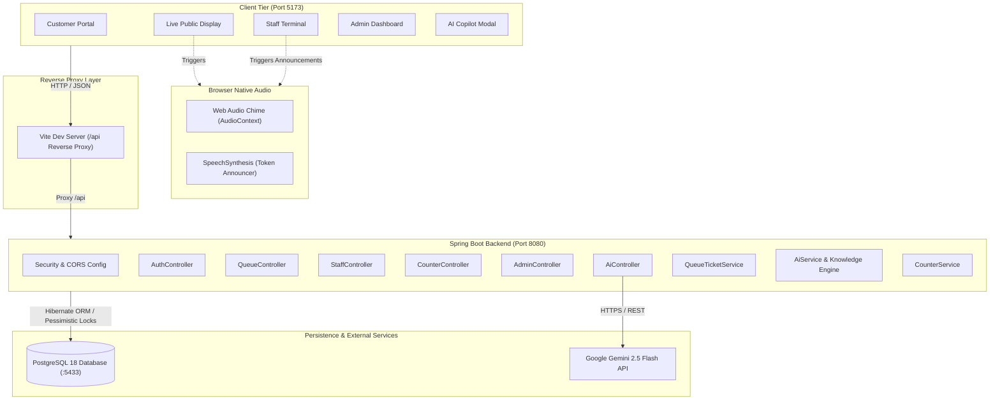
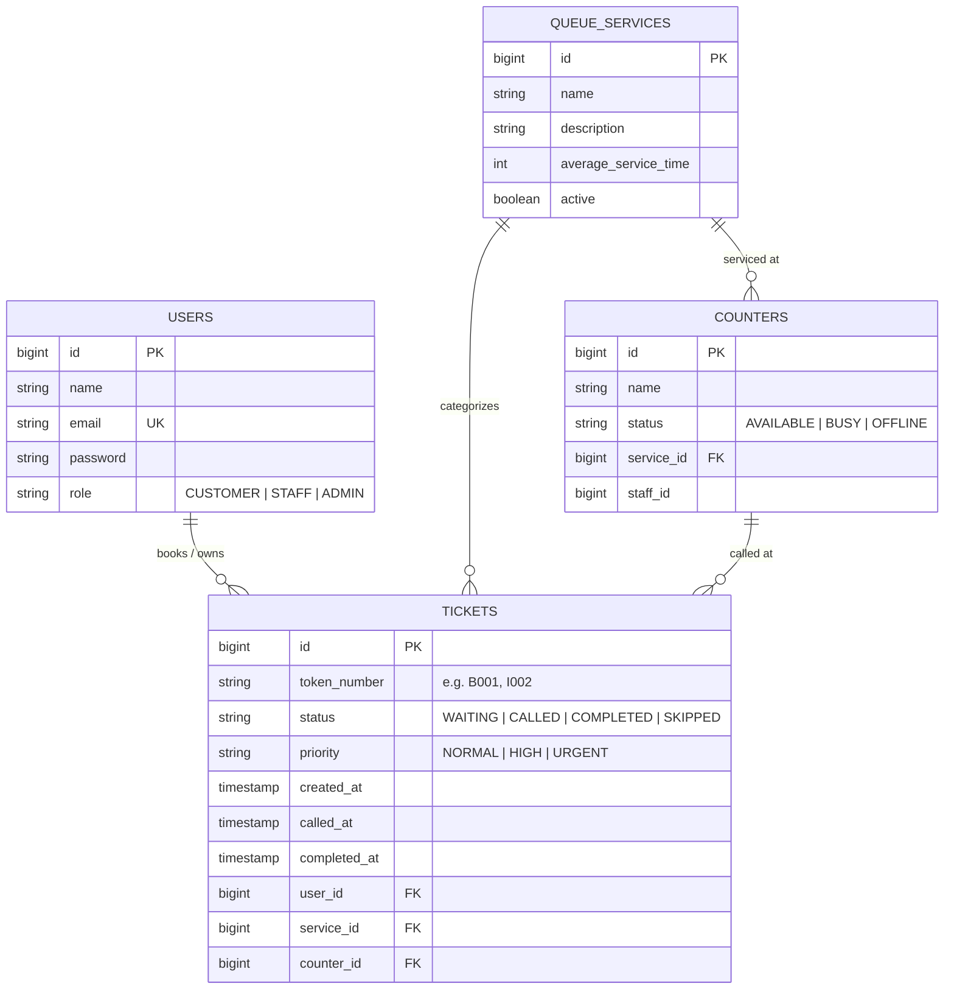

# SmartQueue – Smart Queue Management System

SmartQueue is a modern, full-stack, real-time Queue Management and Smart Dispatching System built for institutions, university campuses, customer service centers, and administrative departments. It eliminates physical waiting crowds by offering digital ticketing, dynamic wait-time estimation, interactive counter staff terminals, large-screen public display boards with voice and audio announcements, supervisory analytics, and an integrated AI Copilot powered by Google Gemini.

---

## 1. Problem Statement & Proposed Solution

### The Problem
Traditional physical queuing systems suffer from critical bottlenecks:
- **Chaotic Waiting Areas:** Visitors crowd counter desks without clear line transparency.
- **Unpredictable Wait Times:** Students and visitors have no visibility into how long their request will take or how many people precede them.
- **Counter Inefficiencies:** Staff members manually announce names or numbers, causing miscommunication and delays.
- **Unprepared Visitors:** People often arrive at service desks without the necessary documentation (e.g., student IDs, clearance receipts), requiring them to return later and join the queue all over again.
- **Lack of Operational Visibility:** Supervisors lack real-time visibility into counter performance, queue congestion, and average handling times.

### The SmartQueue Solution
SmartQueue replaces disorganized physical queues with a synchronized digital workflow:
- **Self-Service Kiosk:** Visitors pick their required service, select their priority level, and immediately receive a digital token (`B001`, `F002`).
- **Live Ticket Tracking:** Visitors track their exact queue position and estimated wait time directly from their phones or screens.
- **Interactive Staff Terminals:** Counter staff call, skip, complete, or recall tickets with a single click, protected against concurrency race conditions via database pessimistic locking.
- **Airport-Style Display Board:** A dedicated public monitor displays active counters and now-serving tokens, complete with browser-native dual-tone chimes and text-to-speech voice broadcasts.
- **SmartQueue AI Copilot:** A conversational AI assistant (powered by Google Gemini with a rule-based institutional knowledge base fallback) clarifies document requirements *before* visitors join the queue.

---

## 2. Features

### ✅ Implemented Features (Current Release)
- **Customer Self-Service Portal:**
  - View live catalog of active institutional services.
  - One-click token issuance with priority selection (`NORMAL`, `HIGH`, `URGENT`).
  - Real-time ticket tracker with live position count and remaining wait minutes.
  - Celebration confetti burst when ticket status changes to `COMPLETED`.
- **Staff Counter Terminal:**
  - Assign staff to physical/virtual counters.
  - Real-time counter status controls (`AVAILABLE`, `BUSY`, `OFFLINE`).
  - Next customer dispatching with priority-first sorting (`URGENT` &rarr; `HIGH` &rarr; `NORMAL`) and FIFO fairness.
  - Action buttons: **Call Next**, **Complete**, **Skip**, and **Recall**.
- **Live Public Display Board:**
  - High-contrast, large-monitor layout for waiting rooms and kiosks.
  - Active "Now Serving" counter cards and public waiting list ticker.
  - Automatic Web Audio dual-tone chime ($587.33\text{ Hz} \to 880\text{ Hz}$).
  - Automatic Web SpeechSynthesis voice announcement (e.g. *"Token number B 0 0 1, please proceed to Counter 01"*).
- **Admin Dashboard & Analytics:**
  - Live system KPIs: Total Tickets, Waiting Count, Serving Count, Completed Count, Skipped Count.
  - Real-time active counter count and average wait-time metrics.
  - Service workload breakdown.
  - Counter creation and status management.
  - Service catalog management (name, description, baseline handling time).
- **SmartQueue AI Copilot:**
  - Direct integration with Google Gemini 2.5 Flash API.
  - Built-in institutional knowledge base fallback for offline/development environments.
  - Automated document checklists (e.g. Bonafide Certificate, ID Card renewal, Fee Clearance).
  - Contextual "Join Queue" actions directly generated inside the assistant chat bubble.
- **Concurrency & Concurrency Protection:**
  - Spring Data JPA Pessimistic Write Locking (`@Lock(LockModeType.PESSIMISTIC_WRITE)`) preventing double-dispatch race conditions when multiple counters call tickets simultaneously.

### ⏳ Planned Features (Future Roadmap)
- **Real-Time Push Notifications (WebSockets):** Transition from current interval polling (3–8s) to Spring WebSocket (STOMP/SockJS) for instantaneous event delivery.
- **High-Throughput Caching (Redis):** Implement Redis Sorted Sets (`ZSET`) to cache queue positions and offload PostgreSQL read traffic during high peak volume.
- **Production Authentication & Security:** Replace mock development tokens with Spring Security JSON Web Tokens (JWT) and BCrypt password hashing.
- **SMS & WhatsApp Alerts:** Send automated text messages when a visitor is 2 positions away from the counter.
- **Containerization & CI/CD:** Provide a multi-stage `Dockerfile`, `docker-compose.yml`, and GitHub Actions workflow for automated testing and deployment.
- **Physical Thermal Kiosk Printer Integration:** ESC/POS printer support for physical paper ticket dispensers.

---

## 3. Technology Stack & Design Decisions

| Technology | Category | Why It Was Chosen |
| :--- | :--- | :--- |
| **Java 24 / 21** | Backend Language | Enterprise-grade stability, strong type safety, and modern virtual threads (Project Loom). |
| **Spring Boot 4.2** | Application Framework | Robust ecosystem, rapid dependency injection, declarative transactions, and mature REST web MVC. |
| **Spring Data JPA & Hibernate 7** | ORM / Persistence | Rapid CRUD operations, object-relational mapping, and database-agnostic SQL generation. |
| **PostgreSQL 18** | Relational Database | ACID transactional guarantees, strong foreign key relational integrity, and robust row-level pessimistic locking (`FOR UPDATE`). |
| **React 19** | Frontend Framework | Declarative component UI, performant state updates, and large modern developer ecosystem. |
| **Vite 8** | Build Tool & Dev Server | Lightning-fast Hot Module Replacement (HMR) and built-in reverse proxying to bypass CORS during development. |
| **TypeScript** | Frontend Language | Compile-time safety, explicit interface definitions, and self-documenting data contracts. |
| **Google Gemini API** | Artificial Intelligence | State-of-the-art conversational reasoning for student guidance, document requirements, and queue triage. |
| **Web Audio & Speech API** | Audio Subsystem | Zero-dependency, native browser audio generation and speech synthesis without requiring third-party audio files or media servers. |

---

## 4. Architecture Diagram



For an in-depth breakdown of architectural patterns, layers, and algorithms, refer to [docs/ARCHITECTURE.md](docs/ARCHITECTURE.md).

---

## 5. Project Folder Structure

```
SmartQueue/
├── backend/
│   ├── .mvn/wrapper/               # Maven wrapper binaries
│   ├── src/main/java/SmartQueueBackend/
│   │   ├── controller/             # REST API Controllers (Auth, Queue, Staff, etc.)
│   │   ├── dto/                    # Data Transfer Objects (Requests & Responses)
│   │   ├── entity/                 # JPA Entities (User, Ticket, QueueService, Counter)
│   │   ├── repository/             # Spring Data JPA Repositories (with Pessimistic Locks)
│   │   ├── security/               # CORS & Security Configuration
│   │   ├── service/                # Business logic, wait time math, and AI engine
│   │   ├── BackendApplication.java # Spring Boot main entrypoint
│   │   └── DataInitializer.java    # Seeds initial database demo records
│   ├── src/main/resources/
│   │   └── application.properties  # Database connection & server port settings
│   ├── pom.xml                     # Maven project descriptor
│   └── mvnw.cmd                    # Windows Maven wrapper script
├── frontend/
│   ├── src/
│   │   ├── components/             # UI Components (CustomerPortal, StaffTerminal, etc.)
│   │   ├── services/               # Frontend API client (api.ts)
│   │   ├── utils/                  # Audio chime & voice announcer (audio.ts)
│   │   ├── types.ts                # TypeScript interfaces and data models
│   │   ├── App.tsx                 # Main application view & tab switcher
│   │   ├── main.tsx                # React DOM entry point
│   │   └── index.css               # Design system, CSS variables & glassmorphism
│   ├── package.json                # Frontend dependencies and scripts
│   ├── tsconfig.json               # TypeScript configuration
│   └── vite.config.ts              # Vite configuration with /api reverse proxy
├── docs/
│   ├── ARCHITECTURE.md             # In-depth architectural analysis and design layers
│   └── API.md                      # Complete REST API reference and verification report
├── CONTRIBUTING.md                 # Contributor guidelines and workflow
└── README.md                       # Main project README
```

---

## 6. Database Schema & Relationships



### Table Details
1. **`users`**: Contains registered administrators, counter operators, and students.
2. **`queue_services`**: Defines service departments and average turnaround times in minutes.
3. **`counters`**: Represents operational windows. Mapped to a specific `queue_services` record.
4. **`tickets`**: Core transactional record tracking the life of each token from creation to completion.

---

## 7. REST API Endpoint Reference

All endpoints are hosted at `http://localhost:8080/api` (or proxied via `http://localhost:5173/api`).

| Method | Endpoint | Description | Verification Status |
| :--- | :--- | :--- | :--- |
| `POST` | `/api/auth/login` | Authenticate user | ✅ Verified |
| `POST` | `/api/auth/register` | Register new user | Verified in Code |
| `POST` | `/api/queue/join` | Issue new ticket token | Verified in Code |
| `GET` | `/api/queue/ticket/{id}` | Live ticket status & position | ✅ Verified |
| `GET` | `/api/queue/user/{userId}` | List tickets created by user | ✅ Verified |
| `GET` | `/api/queue/board` | Live public display board data | ✅ Verified |
| `GET` | `/api/queue/waiting` | List tickets waiting in line | ✅ Verified |
| `POST` | `/api/staff/next` | Call next priority customer | Verified in Code |
| `POST` | `/api/staff/complete/{id}` | Complete service for ticket | Verified in Code |
| `POST` | `/api/staff/skip/{id}` | Skip absent customer | Verified in Code |
| `POST` | `/api/staff/recall/{id}` | Re-broadcast ticket voice call | Verified in Code |
| `GET` | `/api/counters` | List all counter stations | ✅ Verified |
| `GET` | `/api/services` | List all active queue services | ✅ Verified |
| `GET` | `/api/admin/stats` | Global queue metrics & KPIs | ✅ Verified |
| `POST` | `/api/ai/chat` | Query AI Copilot / Knowledge Engine | ✅ Verified |

For exhaustive request/response schemas, sample JSON payloads, and error conditions, see [docs/API.md](docs/API.md).

---

## 8. Prerequisites & Local Setup Guide

### System Prerequisites
- **Operating System:** Windows 10/11, macOS, or Linux.
- **Java:** JDK 21 or higher (OpenJDK or Oracle; tested with Java 24).
- **Node.js:** v18.0.0 or higher (tested with Node v22.14.0, includes `npm`).
- **PostgreSQL:** Version 15+ (tested on PostgreSQL 18, default port `5433` or `5432`).

### 1. Database Configuration
Ensure PostgreSQL is running and create the database:
```sql
CREATE DATABASE smart_queue;
```

Update your connection credentials in `backend/src/main/resources/application.properties`:
```properties
spring.application.name=SmartQueueBackend
spring.datasource.url=jdbc:postgresql://localhost:5433/smart_queue
spring.datasource.username=postgres
spring.datasource.password=<your-database-password>

spring.jpa.hibernate.ddl-auto=update
spring.jpa.show-sql=true
server.port=8080
```
> ⚠️ **Important:** Replace `<your-database-password>` with your actual password. Do not commit actual passwords or API keys to GitHub.

### 2. Optional: Configure Google Gemini API Key
If you want the AI Copilot to query live Google Gemini models, set the environment variable:
```powershell
$env:GEMINI_API_KEY="your-gemini-api-key"
```
*(If omitted, SmartQueue automatically falls back to its built-in institutional knowledge base).*

---

## 9. How to Run the Project (Windows PowerShell)

### Step 1: Launch Backend Server
Open a PowerShell terminal:
```powershell
# Navigate to the backend directory
cd backend

# Run the Spring Boot application using the Maven wrapper
.\mvnw.cmd spring-boot:run
```
The backend will compile, run database migrations, seed default demo data, and start on **`http://localhost:8080`**.

### Step 2: Launch Frontend Application
Open a second PowerShell terminal:
```powershell
# Navigate to the frontend directory
cd frontend

# Install npm dependencies (first time only)
npm install

# Start the Vite development server
npm run dev
```
The frontend will start on **`http://localhost:5173`**.

Open your browser and navigate to **`http://localhost:5173`**.

---

## 10. How to Test APIs Using Postman

You can easily test and automate requests to the SmartQueue backend using Postman.

### Setup Instructions
1. Open Postman and click **New &rarr; Collection**. Name it `SmartQueue API`.
2. Add a Collection Variable:
   - Variable: `baseUrl`
   - Initial / Current Value: `http://localhost:8080/api`

### Sample Requests to Add

#### 1. Fetch Active Services
- **Method:** `GET`
- **URL:** `{{baseUrl}}/services`
- **Headers:** None required.
- **Expected Status:** `200 OK` (returns JSON array of services).

#### 2. Join Queue (Create Ticket)
- **Method:** `POST`
- **URL:** `{{baseUrl}}/queue/join`
- **Headers:** `Content-Type: application/json`
- **Body (raw JSON):**
```json
{
  "serviceId": 1,
  "userName": "Alex Johnson",
  "userEmail": "student@smartqueue.com",
  "priority": "HIGH"
}
```
- **Expected Status:** `200 OK` (returns ticket object with generated `tokenNumber` like `B001`).

#### 3. Check Ticket Live Status
- **Method:** `GET`
- **URL:** `{{baseUrl}}/queue/ticket/1`
- **Expected Status:** `200 OK` (returns position ahead and estimated wait minutes).

#### 4. Staff Call Next Customer
- **Method:** `POST`
- **URL:** `{{baseUrl}}/staff/next?serviceId=1&counterId=1`
- **Expected Status:** `200 OK` (returns ticket updated to `CALLED`).

#### 5. Query AI Copilot
- **Method:** `POST`
- **URL:** `{{baseUrl}}/ai/chat`
- **Headers:** `Content-Type: application/json`
- **Body (raw JSON):**
```json
{
  "message": "What documents do I need for Bonafide certificate?"
}
```
- **Expected Status:** `200 OK` (returns checklist and recommended service ID).

---

## 11. Screenshots & Interface Preview

*(Screenshots can be placed in `docs/screenshots/`)*

### Customer Self-Service Portal

*Figure 1: Visitors select their department, request digital tokens, and track real-time queue position.*

### Live Public Display Board

*Figure 2: Public hall screen displaying active counters, called tokens, and audio announcements.*

### Staff Counter Terminal

*Figure 3: Counter personnel call next priority ticket, skip no-shows, and complete customer requests.*

### Admin Analytics & KPI Dashboard

*Figure 4: Supervisory overview of queue depths, wait times, and counter statuses.*

---

## 12. Testing Strategy, Current Limitations & Enhancements

### Testing Strategy
- **Unit & Integration Testing:** Spring Boot test starters (`spring-boot-starter-test`, `spring-boot-starter-data-jpa-test`) configured in `pom.xml`.
- **Manual End-to-End Validation:** Verified via PowerShell REST client and Postman across authentication, queue entry, counter calling, and public display polling.
- **Concurrency Verification:** Validated pessimistic write locking on `TicketRepository` to ensure ticket dispatch atomicity under multi-counter contention.

### Current Limitations
1. **Polling vs WebSockets:** The current public board and customer tracker poll the server every 3–8 seconds. Under thousands of concurrent viewers, this creates avoidable HTTP load.
2. **Development Security:** Spring Security is currently configured to permit all requests (`permitAll()`), passwords are checked in plain text, and tokens are mock strings (`mock-token-{id}`).
3. **Exception Translation:** Unhandled business exceptions (such as user not found) currently return HTTP 500 instead of standard HTTP 400/404 responses. A centralized `@ControllerAdvice` is planned.

### Planned Enhancements
- [ ] Migrate real-time communication to Spring WebSockets with STOMP.
- [ ] Implement Redis-backed token queues and session caching.
- [ ] Integrate JWT authentication and BCrypt password encryption.
- [ ] Create automated unit and integration tests using JUnit 5 and Mockito.
- [ ] Add Docker containerization (`Dockerfile` and `docker-compose.yml`).
- [ ] Add GitHub Actions CI workflow to run automated linting and build checks on pull requests.

---

## 13. Contributing

We welcome community contributions! Please read our [CONTRIBUTING.md](CONTRIBUTING.md) guide for details on branching, coding standards, commit formatting, and pull request procedures.

---

## 14. License

This project is licensed under the [MIT License](LICENSE).
