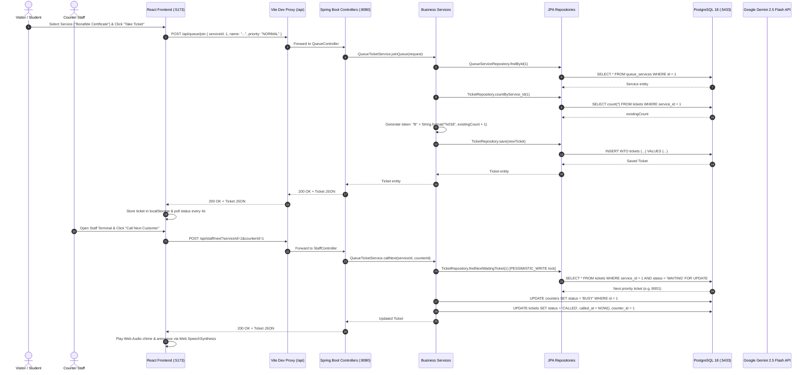
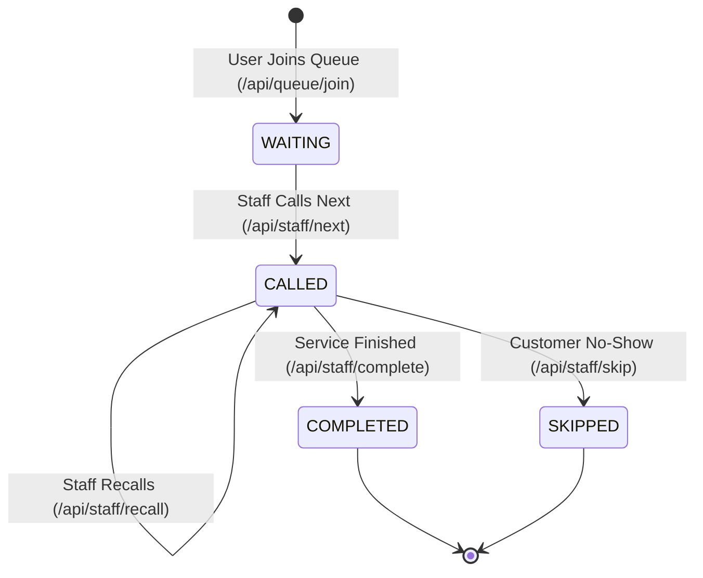

# SmartQueue Architecture Documentation

This document describes the internal architecture, design patterns, data flow, concurrency controls, and future architectural roadmaps for **SmartQueue – Smart Queue Management System**.

---

## 1. End-to-End System Flow

The diagram below illustrates the end-to-end lifecycle when a visitor interacts with the frontend, sends requests through the reverse proxy to Spring Boot, and persists data into PostgreSQL.



---

## 2. Layered Architecture (Spring Boot)

The backend follows a classic 5-tier architecture to enforce separation of concerns, maintainability, and clean code principles:

```
SmartQueueBackend/
├── controller/     --> REST API Layer (HTTP handling, query params, path variables)
├── dto/            --> Data Transfer Objects (contracts for requests and custom responses)
├── service/        --> Business Logic Layer (queue assignment, wait time formulas, AI fallback)
├── repository/     --> Data Access Layer (Spring Data JPA interfaces, JPQL, pessimistic locking)
├── entity/         --> Domain Model Layer (JPA mapped classes with database schema bindings)
└── security/       --> Security Configuration (CORS, CSRF policies, public endpoints)
```

### 2.1 Entity Layer (`entity/`)
Defines the core database schema mapped using JPA annotations (`@Entity`, `@Table`, `@Id`, `@GeneratedValue`, `@ManyToOne`, `@JoinColumn`):
- **`User`**: System actors with roles (`CUSTOMER`, `STAFF`, `ADMIN`).
- **`QueueService`**: The catalog of institutional offerings (e.g., Bonafide Certificates, ID Card Issuance) along with baseline average service duration in minutes.
- **`Counter`**: Physical or virtual processing stations with operational states (`AVAILABLE`, `BUSY`, `OFFLINE`) and foreign-key link to `QueueService`.
- **`Ticket`**: The transactional token record tracking timestamps (`createdAt`, `calledAt`, `completedAt`), queue status (`WAITING`, `CALLED`, `COMPLETED`, `SKIPPED`), priority (`NORMAL`, `HIGH`, `URGENT`), and relational associations to `User`, `QueueService`, and `Counter`.

### 2.2 DTO Layer (`dto/`)
Decouples internal JPA entities from external network contracts to prevent over-posting vulnerabilities and recursive JSON serialization:
- `JoinQueueRequest`: Payload for customers joining a queue.
- `LoginRequest`: Credentials for authenticating users.
- `AuthResponse`: Authentication confirmation returning user profile and token.
- `CreateCounterRequest`: Admin payload for registering service counters.
- `TicketStatusResponse`: Live status envelope containing the ticket, current position ahead in line, and dynamic estimated wait minutes.
- `QueueBoardResponse`: Aggregated payload for public TV display boards (list of currently called tickets, waiting token list, active counter count).
- `QueueStatsResponse`: Supervisory metrics for the admin portal.
- `AiChatRequest` & `AiChatResponse`: Request and response envelopes for the Gemini AI / Knowledge Engine integration.

### 2.3 Repository Layer (`repository/`)
Inherits from Spring Data's `JpaRepository<T, ID>`:
- Provides declarative CRUD queries derived from method names (e.g. `countByStatus`, `findByUser_IdOrderByIdDesc`).
- **Concurrency Protection with Pessimistic Locking**: In `TicketRepository.java`, the `findNextWaitingTicket` method applies `@Lock(LockModeType.PESSIMISTIC_WRITE)`. Under the hood, this translates to a `SELECT ... FOR UPDATE` SQL query in PostgreSQL, preventing multiple staff members at different counters from claiming the same ticket concurrently during peak hours.

### 2.4 Service Layer (`service/`)
Houses all business rules, orchestration, and transactional boundaries (`@Transactional`):
- **`QueueTicketService`**: Manages ticket creation, priority sorting, token assignment, status transitions, position calculations, and live board aggregation.
- **`CounterService`**: Manages counter registration and state updates (`AVAILABLE`, `BUSY`, `OFFLINE`).
- **`UserService`**: Handles user creation, authentication checks, and visitor resolution.
- **`QueueServiceManager`**: Manages the catalog of available queue services.
- **`AiService`**: Orchestrates Google Gemini API queries with an integrated, rule-based fallback knowledge engine.

### 2.5 Controller Layer (`controller/`)
Exposes HTTP endpoints annotated with `@RestController` and `@RequestMapping`:
- `AuthController`: User registration, login, and profile lookup.
- `QueueController`: Customer queue entry, status queries, waiting ticket views, and live board data.
- `StaffController`: Counter operations (`next`, `complete`, `skip`, `recall`).
- `CounterController`: Counter directory and status modification.
- `QueueServiceController`: Service catalog management.
- `AdminController`: Aggregated analytics and reporting.
- `AiController`: AI assistant interaction and health checks.

---

## 3. Queue Logic, Token Generation & Wait-Time Estimation

### 3.1 Token Number Generation
Token numbers are created sequentially per service using a clean prefix-based format:
1. Extract the uppercase initial letter of the service name (e.g., `Bonafide Certificate` &rarr; `B`, `Fee Payment` &rarr; `F`).
2. Query total existing tickets for this service via `ticketRepository.countByService_Id(service.getId())`.
3. Concatenate the prefix with a 3-digit zero-padded counter (`existingTickets + 1`).
   - Example tokens: `B001`, `B002`, `I001`, `F001`.

### 3.2 Priority-First Queue Dispatching
When a counter staff member calls for the next ticket, the repository evaluates tickets via custom JPQL ordering:

```sql
SELECT t FROM Ticket t
WHERE t.service.id = :serviceId
  AND t.status = 'WAITING'
ORDER BY 
    CASE t.priority 
        WHEN 'URGENT' THEN 1 
        WHEN 'HIGH' THEN 2 
        ELSE 3 
    END ASC,
    t.id ASC
```

This guarantees that:
- Emergency or high-priority tickets jump ahead of standard tickets.
- Among tickets with the same priority, First-In-First-Out (FIFO) ordering is strictly preserved by ticket ID.

### 3.3 Dynamic Wait-Time Estimation Formula
When a visitor checks their ticket via `/api/queue/ticket/{ticketId}`, the backend dynamically calculates the estimated wait time:

$$\text{Estimated Wait (minutes)} = \left\lceil \frac{(\text{Position Ahead} + 1) \times \text{Average Service Time}}{\text{Active Counters for this Service}} \right\rceil$$

Adjustments are applied based on priority weighting:
- `URGENT`: Reduced to $40\%$ of the standard wait time (minimum 1 minute).
- `HIGH`: Reduced to $70\%$ of the standard wait time (minimum 2 minutes).
- `NORMAL`: Full calculated duration.

### 3.4 Ticket Lifecycle State Machine



---

## 4. Current vs. Planned Architectural Capabilities

To maintain full transparency, the table below highlights what is currently implemented in the codebase versus what is planned for future versions:

| Architecture Area | Current Implementation Status | Planned Future Implementation |
| :--- | :--- | :--- |
| **Real-Time Updates** | **Implemented via Polling**: React client polls `/api/queue/board` and `/api/queue/ticket/{id}` every 3–8 seconds via `setInterval`. | **Planned**: Spring WebSocket with STOMP & SockJS for real-time pub/sub event broadcasting directly upon status transitions. |
| **Concurrency & Queue Storage** | **Implemented via Database**: PostgreSQL with JPA Pessimistic Write Locking (`@Lock(LockModeType.PESSIMISTIC_WRITE)`) on the `Ticket` table. | **Planned**: Redis Sorted Sets (`ZSET`) for sub-millisecond in-memory priority queue dispatching, reducing PostgreSQL write lock contention under massive concurrency. |
| **Authentication & Tokens** | **Implemented for Dev**: Mock token generator (`mock-token-{id}`) and plaintext password checks for rapid prototyping. | **Planned**: Spring Security filter chain with JSON Web Tokens (JWT), BCrypt password hashing, and role-based access control (`@PreAuthorize`). |
| **AI Integration** | **Implemented**: Direct HTTP integration with Google Gemini 2.5 Flash API via `HttpClient` in `AiService.java`, paired with a comprehensive rule-based knowledge fallback engine for document checklists. | **Planned**: Retrieval-Augmented Generation (RAG) using institutional PDF documents and multilingual audio input/output. |
| **Audio Announcements** | **Implemented**: Client-side Web Audio API dual-tone chime synthesizer ($587.33\text{ Hz} \to 880\text{ Hz}$) and `window.speechSynthesis` phonetic voice engine in `audio.ts`. | **Planned**: Server-side Webhook dispatch to physical IP-based PA systems and WhatsApp/SMS notification triggers. |
| **Containerization & CI/CD** | **Implemented Locally**: Standard Maven and npm scripts running locally on Windows/Linux. | **Planned**: Multi-stage `Dockerfile`, `docker-compose.yml` for unified backend/frontend/PostgreSQL startup, and GitHub Actions CI workflow. |
